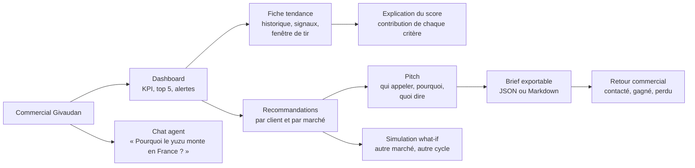
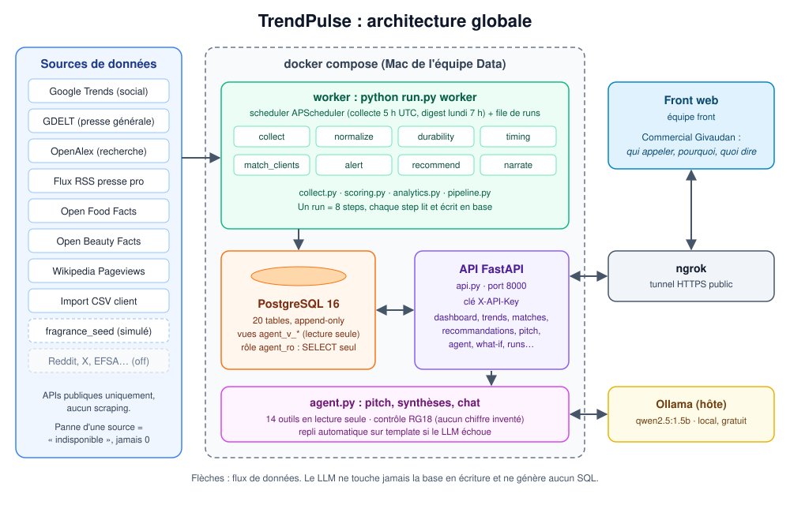
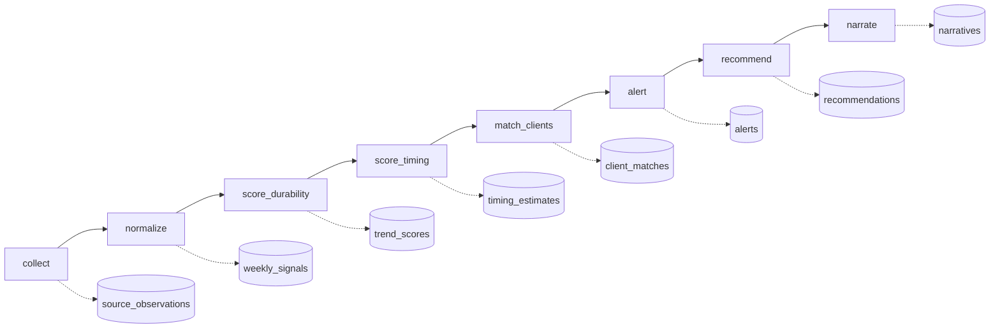
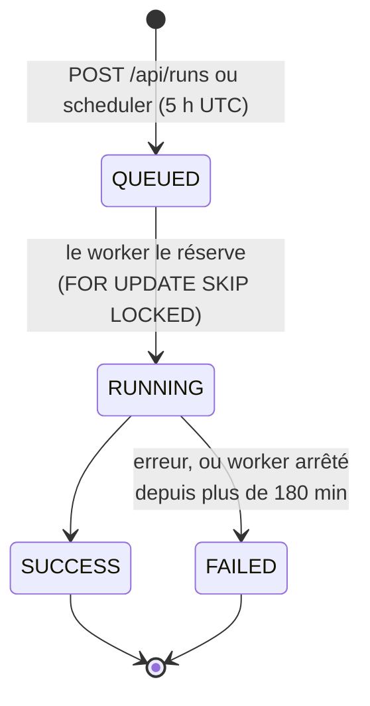
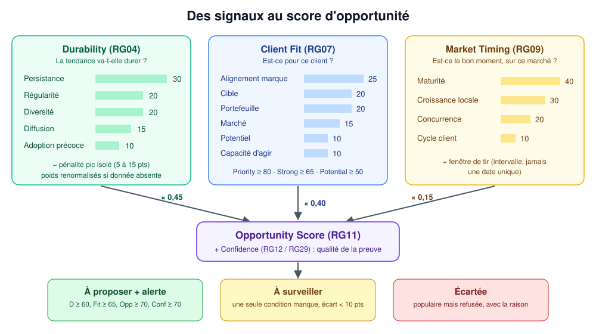
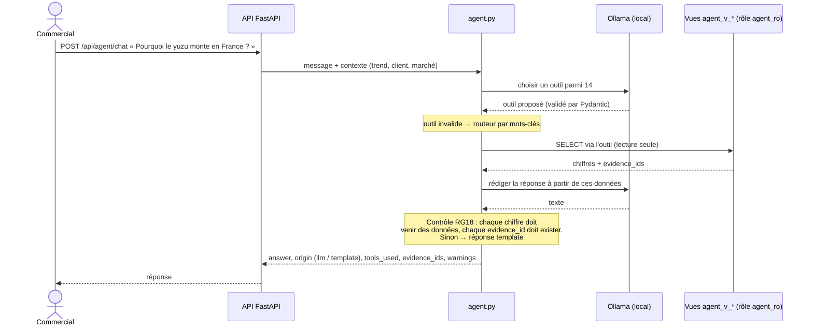
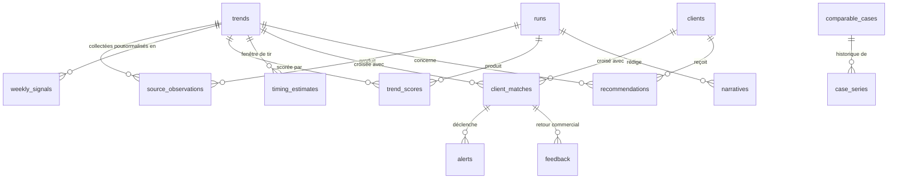
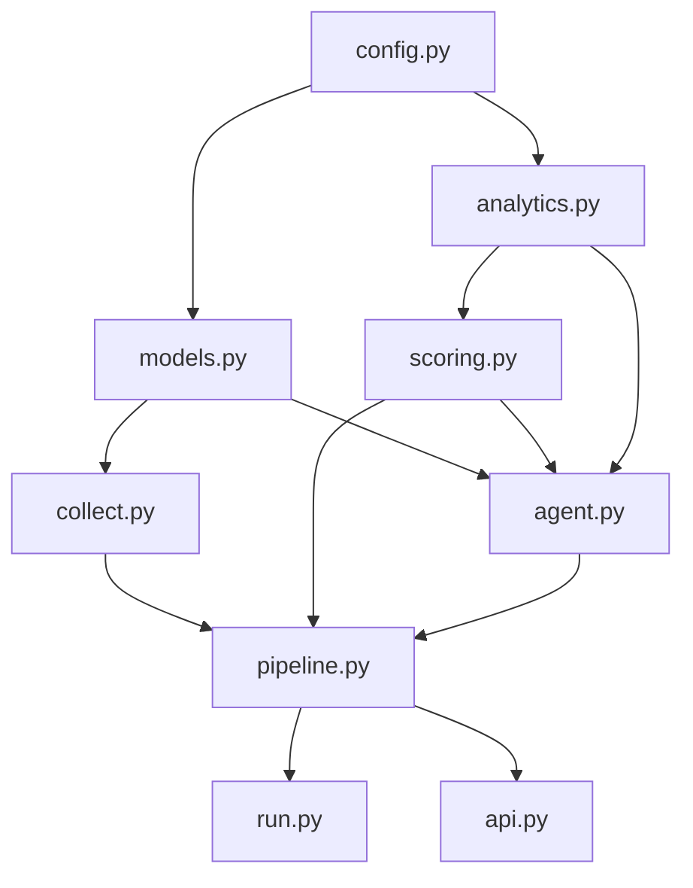

# TrendPulse : dossier livrable

> **TrendPulse indique à Givaudan qui appeler, pourquoi maintenant, et quoi dire.**

Givaudan AI Challenge, HETIC, sujet 3. Groupe 20, volet Data et IA.
Document de référence pour le jury, les Product Owners et l'équipe. Version du 12 novembre 2026.

---

## Sommaire

1. [Le problème](#1-le-problème)
2. [Notre réponse](#2-notre-réponse)
3. [Parcours utilisateur](#3-parcours-utilisateur)
4. [Architecture globale](#4-architecture-globale)
5. [Le pipeline de données](#5-le-pipeline-de-données)
6. [Les sources de données](#6-les-sources-de-données)
7. [Le moteur de scoring](#7-le-moteur-de-scoring)
8. [Recommandations](#8-recommandations)
9. [L'IA générative : un agent encadré](#9-lia-générative--un-agent-encadré)
10. [Modèle de données](#10-modèle-de-données)
11. [L'API](#11-lapi)
12. [Organisation du code](#12-organisation-du-code)
13. [Choix techniques et pourquoi](#13-choix-techniques-et-pourquoi)
14. [Honnêteté des données](#14-honnêteté-des-données)
15. [Qualité et tests](#15-qualité-et-tests)
16. [Déploiement et exploitation](#16-déploiement-et-exploitation)
17. [Limites connues et suite](#17-limites-connues-et-suite)

---

## 1. Le problème

Givaudan crée des arômes et des parfums pour des marques de l'agroalimentaire, de la beauté et de la parfumerie. Pour ses commerciaux, une tendance (le yuzu, le matcha, la mucine d'escargot…) n'a de valeur que si trois conditions sont réunies :

- **elle dure** : ce n'est pas un pic viral qui retombe en trois semaines ;
- **elle concerne un client précis** : sa marque, sa cible, son portefeuille, son marché ;
- **le moment est le bon** : ni trop tôt (marché pas prêt), ni trop tard (tout le monde l'a déjà lancée).

Aujourd'hui, ces signaux sont dispersés : recherches Google, presse générale et professionnelle, publications scientifiques, lancements de produits. Personne ne les croise de façon systématique, ni par client, ni par marché.

## 2. Notre réponse

TrendPulse est une plateforme qui :

1. **collecte** chaque jour des signaux publics sur 8 tendances, 3 secteurs (food_beverage, fragrance, beauty) et 6 marchés (FR, US, GB, DE, JP, KR) ;
2. **mesure** la durabilité de chaque tendance, son adéquation à chaque client et le bon moment sur chaque marché ;
3. **recommande** au commercial, client par client, les tendances à proposer, à surveiller ou à écarter, avec les preuves et les signaux contraires ;
4. **rédige** un pitch, des synthèses et répond aux questions par un agent conversationnel, sans jamais inventer un chiffre.

Deux principes guident tout le projet :

- **Maintenabilité** : un code court, plat, lisible, testé, qu'une autre équipe peut reprendre.
- **Honnêteté des données** : une donnée absente n'est jamais un zéro, une donnée simulée est toujours étiquetée, aucun taux de précision n'est affiché sans base solide.

## 3. Parcours utilisateur



Exemple concret : pour le client de démonstration `CLI-FB-01` sur le marché `FR`, l'écran recommandations répond « proposer le yuzu ». Il donne les preuves (hausse de la presse, lancements Open Food Facts, persistance sur 26 semaines), les signaux contraires (rétention après pic, concurrence) et une action suggérée formulée comme une exploration commerciale, sans promesse.

## 4. Architecture globale



Le système tient en **trois services Docker** et deux composants sur l'hôte :

| Composant | Rôle | Techno |
|---|---|---|
| `db` | Stockage de tout l'historique, append-only | PostgreSQL 16 |
| `worker` | Exécute les runs de collecte et de scoring, embarque le scheduler | Python, APScheduler |
| `api` | Expose les résultats au front et à l'agent | FastAPI, Uvicorn |
| Ollama (hôte) | LLM local pour le pitch, les synthèses et l'agent | qwen2.5:1.5b |
| ngrok (hôte) | Tunnel HTTPS public pour le front | ngrok |

**Pourquoi un worker séparé de l'API ?** Une collecte complète interroge une dizaine d'API externes avec des pauses imposées (GDELT : une requête toutes les 10 secondes). Elle dure plusieurs minutes. L'API reste disponible pendant ce temps : `POST /api/runs` crée un run en file d'attente et répond tout de suite, le worker l'exécute en arrière-plan.

**Pourquoi le LLM tourne en local ?** Pas de coût par appel, pas de données client envoyées à un tiers, et le système fonctionne sans LLM : chaque texte a un template de repli.

## 5. Le pipeline de données

Un **run** est une exécution complète du pipeline. Il passe par 8 étapes, chacune lit et écrit en base :



| Étape | Ce qu'elle fait |
|---|---|
| `collect` | Interroge chaque source active. Chaque collecteur est isolé (`safe_collect`) : une panne est notée dans `runs.source_status` et n'arrête pas les autres. |
| `normalize` | Ramène tout en signaux hebdomadaires par tendance, marché et source. Seules les semaines closes sont gardées. |
| `score_durability` | Calcule la Durability v1 (fiche de l'équipe) et v2 (statistiques robustes), avec intervalle et confiance. |
| `score_timing` | Calcule le Market Timing et la fenêtre de tir par marché. |
| `match_clients` | Croise chaque tendance avec chaque client : Client Fit et Opportunity. |
| `alert` | Lève une alerte quand les 4 seuils RG13 sont franchis. |
| `recommend` | Répartit les tendances en paniers par client et par marché, avec preuves et signaux contraires. |
| `narrate` | Rédige les actions suggérées et les synthèses (LLM ou template). |

**Cycle de vie d'un run** :



Un seul run actif à la fois, garanti par un verrou consultatif PostgreSQL. Chaque step correspond à une future `@task` Airflow du même nom : la migration vers Airflow est prévue sans réécriture.

## 6. Les sources de données

| Source | Ce qu'elle mesure | Type (diversité) | Statut |
|---|---|---|---|
| Google Trends | Intérêt de recherche | social | actif, fragile (non officiel) |
| GDELT | Volume et ton de la presse mondiale | presse générale | actif |
| OpenAlex | Publications scientifiques | recherche académique | actif avec clé |
| Flux RSS | Presse professionnelle | presse professionnelle | 10 flux, désactivés en attente des conditions d'usage |
| Open Food Facts | Lancements de produits food | lancement produit | actif |
| Open Beauty Facts | Lancements beauté et parfum | lancement produit | actif, couverture partielle |
| Wikipedia Pageviews | Notoriété | hors diversité | actif |
| Import CSV client | Ventes réelles du client | retail / e-commerce | sur fichier fourni |
| fragrance_seed | Échantillon parfum | lancement produit | **simulé**, étiqueté |
| Reddit, X, EFSA, FDA, Espacenet | | | désactivés ou non implémentés |

**Pourquoi ces sources ?** Elles sont publiques, gratuites et documentées, et couvrent la chaîne de diffusion d'une tendance : recherche scientifique, puis presse professionnelle, presse générale, recherches des consommateurs, et enfin lancements de produits. La **diversité** des types de sources est un critère du score : une tendance visible partout est plus solide qu'une tendance vue uniquement sur un réseau social.

Règles communes à tous les collecteurs :
- aucun scraping de site marchand ni de réseau social ;
- pauses, backoff et cache propres à chaque source (Google Trends : cache 24 h) ;
- une source en panne donne « indisponible », jamais zéro ; une requête réussie qui renvoie zéro est une vraie valeur observée.

## 7. Le moteur de scoring



### 7.1 Durability : la tendance va-t-elle durer ?

Cinq critères pondérés selon la fiche de scoring de l'équipe :

| Critère | Poids | Mesure |
|---|---|---|
| Persistance | 30 | Part des 26 dernières semaines au-dessus du niveau de base |
| Régularité | 20 | Croissance régulière plutôt qu'en dents de scie (tau de Kendall, pente de Theil-Sen) |
| Diversité | 20 | Nombre de types de sources où la tendance apparaît |
| Diffusion | 15 | Nombre de marchés et de catégories touchés |
| Adoption précoce | 10 | Présence dans les sources « en amont » (recherche, presse pro) |

**Pénalité événementielle (RG06)** : un pic isolé, suivi d'une faible rétention, retire 5 à 15 points. C'est le garde-fou anti-buzz (cas Dubai Chocolate).

**Renormalisation (RG05)** : si un critère n'a pas de donnée, il est retiré et les poids restants sont ramenés à 100. Le score ne baisse pas à cause d'une source en panne. La confiance, elle, baisse.

### 7.2 Deux versions du score, côte à côte

| | v1 (fiche de l'équipe) | v2 (statistiques robustes) |
|---|---|---|
| Persistance | seuil fixe | médiane de base + 1 MAD |
| Régularité | régression linéaire | Kendall + Theil-Sen − dispersion des résidus |
| Saisonnalité | ignorée | décomposition STL si 104 semaines et saison détectée |
| Pic viral | pénalité fixe | z-score robuste > 3 et rétention < 0,6, pénalité de 5 à 15 |
| Incertitude | aucune | bootstrap par blocs : intervalle P10 à P90, flag `class_uncertain` |
| Analogues | aucun | DTW contre des cas historiques vérifiés |

La v2 est utilisée en aval. La v1 reste calculée et stockée pour comparaison (`python run.py backtest --compare v1 v2`). **Pourquoi garder les deux ?** Pour que les Product Owners puissent vérifier que la v2 améliore réellement la fiche validée, au lieu de la croire sur parole.

### 7.3 Client Fit, Timing, Opportunity, Confidence

- **Client Fit (RG07)** : alignement marque 25, cible 20, portefeuille 20, marché 15, potentiel 10, capacité d'agir 10. Niveaux : Priority ≥ 80, Strong ≥ 65, Potential ≥ 50.
- **Market Timing (RG09)** : maturité 40, croissance locale 30, concurrence 20, cycle d'innovation du client 10. Il donne une **fenêtre de tir** sous forme d'intervalle, jamais une date unique.
- **Opportunity (RG11)** : `0,45 × Durability + 0,40 × Fit + 0,15 × Timing`.
- **Confidence (RG12, RG29)** : qualité de la preuve (nombre de types de sources, profondeur d'historique, fraîcheur, couverture du marché, cas vérifiés, précision de l'intervalle).

### 7.4 Explicabilité

`GET /api/trend/{id}/explain` renvoie la contribution en points de chaque critère. **La somme des contributions est égale au score affiché.** Un commercial peut donc justifier chaque chiffre devant son client.

## 8. Recommandations

Pour chaque client et chaque marché, les tendances sont rangées dans trois paniers (RG33) :

| Panier | Condition | Limite |
|---|---|---|
| **À proposer** | Durability ≥ 60, Fit ≥ 65, Opportunity ≥ 70, Confidence ≥ 70 | 5 |
| **À surveiller** | une seule condition manque, avec un écart de moins de 10 points | 5 |
| **Écartées** | tendance populaire (top 20 % des hausses récentes) refusée, avec la raison | 3 |

Chaque recommandation contient :
- **des preuves** : chaque justification cite un `evidence_id` qui existe en base (RG34) ;
- **des signaux contraires** calculés en code, jamais vides (RG35) : rétention faible, peu de types de sources, lancements en baisse… ;
- **l'évolution** depuis le run précédent : nouveau, monte, stable, baisse, sorti ;
- **une action suggérée** rédigée par le LLM, formulée comme une exploration commerciale.

**Pourquoi un panier « Écartées » ?** Un commercial entendra parler des tendances à la mode. Expliquer pourquoi l'une d'elles ne convient pas à son client est aussi utile que d'en proposer une.

## 9. L'IA générative : un agent encadré

Le LLM **rédige**, il ne **décide** pas. Tous les scores sont calculés en code, de façon déterministe.



Garde-fous :

| Risque | Parade |
|---|---|
| Le LLM invente un chiffre | Contrôle RG18 : tout nombre de la réponse doit figurer dans les sorties d'outils, sinon repli sur le template |
| Le LLM modifie la base | Rôle PostgreSQL `agent_ro` : `SELECT` uniquement, sur des vues dédiées. Aucun SQL généré par le LLM |
| Injection de prompt via un titre d'article | Les textes externes sont nettoyés et isolés, et leurs chiffres ne comptent pas comme preuve |
| Promesse commerciale abusive | Prompt système et template : « exploration commerciale », jamais de garantie |
| LLM indisponible | Chaque texte a un template. Le champ `origin` indique `llm` ou `template` |

Mentions obligatoires ajoutées automatiquement : classe incertaine, saisonnalité inconnue, historique court, données non disponibles, ton de la presse (qui n'est pas un avis de consommateurs).

## 10. Modèle de données



Les 20 tables, par rôle :

| Rôle | Tables |
|---|---|
| Référentiels | `trends`, `clients`, `comparable_cases`, `known_events`, `calendar_events`, `case_series` |
| Exécution | `runs`, `notifications` |
| Données brutes et normalisées | `source_observations`, `weekly_signals` |
| Résultats | `trend_scores`, `timing_estimates`, `client_matches`, `alerts`, `recommendations`, `narratives`, `trend_candidates` |
| Usage et évaluation | `chat_messages`, `feedback`, `backtest_results` |

**Append-only (RG14)** : aucun score n'est modifié après coup. Chaque ligne référence son `run_id`, sa `scoring_version` et les `observation_ids` qui la justifient. On peut toujours dire pourquoi un score valait telle valeur tel jour.

## 11. L'API

API REST FastAPI. Documentation interactive sur `/docs`, schéma OpenAPI sur `/openapi.json`. Toutes les routes exigent l'en-tête `X-API-Key`, sauf `GET /api/health`.

| Écran du front | Route |
|---|---|
| Dashboard | `GET /api/dashboard` |
| Liste et fiche tendance | `GET /api/trends`, `GET /api/trends/{trend_id}` |
| Explication du score | `GET /api/trend/{trend_id}/explain` |
| Alertes, clients, matches | `GET /api/alerts`, `GET /api/clients`, `GET /api/matches` |
| Recommandations | `GET /api/recommendations/{client_id}?market=FR` |
| Pitch | `GET /api/pitch/{trend_id}/{client_id}` |
| Brief exportable | `GET /api/brief/{match_id}?format=markdown` |
| Chat et synthèses | `POST /api/agent/chat`, `POST /api/agent/synthesis` |
| What-if | `POST /api/whatif` (rien n'est enregistré) |
| Retour commercial | `POST /api/feedback` |
| Projection | `GET /api/predict/{trend_id}` (optionnelle) |
| Concepts émergents | `GET /api/discover` |
| Collecte | `POST /api/runs`, `GET /api/runs/{id}` |
| Import client | `POST /api/clients/import` |

## 12. Organisation du code

Structure **plate** : 9 fichiers sources, 3 fichiers de tests, des référentiels en CSV et JSON.

```
trendpulse/
├── config.py        Toutes les constantes et seuils (valeurs « A VALIDER » marquées)
├── models.py        Contrats Pydantic, tables SQLAlchemy, vues de l'agent, migration
├── collect.py       Un collecteur par source, registre, normalisation hebdomadaire
├── scoring.py       Durability, Fit, Timing, Opportunity, Confidence, paniers (calcul pur)
├── analytics.py     Saisonnalité, bootstrap, DTW, projection, découverte (calcul pur)
├── agent.py         Pitch, synthèses, agent en lecture seule, contrôle RG18
├── pipeline.py      Les 8 steps d'un run, notifications, what-if, brief
├── api.py           API FastAPI
├── run.py           Commandes : worker, scheduler, seed, backtest, db-upgrade, discover
├── data/seed/       Tendances, clients de démo, cas comparables, calendrier, flux RSS
├── test_*.py        174 tests
├── Dockerfile, docker-compose.yml
└── docs/            Ce dossier
```



**Pourquoi une structure plate ?** Le projet est court et l'équipe change. Neuf fichiers aux noms explicites se lisent plus vite qu'une arborescence de packages. Chaque fichier est découpé en sections commentées, et chaque règle métier porte son identifiant (`RG04`, `RG13`…), ce qui permet de passer de la fiche de scoring au code avec une simple recherche.

**Pourquoi des fonctions de calcul pures ?** `scoring.py` et `analytics.py` n'accèdent ni à la base ni au réseau. On les teste avec des séries écrites à la main, et on peut les réutiliser telles quelles dans Airflow, un notebook ou un autre service.

## 13. Choix techniques et pourquoi

| Choix | Raison | Alternative écartée |
|---|---|---|
| Python | Écosystème data (pandas, scipy, statsmodels), compétences de l'équipe | |
| FastAPI | Validation Pydantic, documentation OpenAPI automatique pour le front | Flask (pas de schéma automatique) |
| PostgreSQL 16 | JSONB, verrous pour la file de runs, rôles pour isoler l'agent | SQLite (gardé pour le dev local et les tests) |
| SQLAlchemy | Même code sur PostgreSQL et SQLite | SQL écrit à la main |
| Worker et scheduler maison (APScheduler) | 3 services Docker au lieu de 6, suffisant à cette échelle | Airflow, Celery et Redis (prévus, mais trop lourds pour un hackathon) |
| Ollama en local | Gratuit, confidentiel, hors ligne | API LLM payante dans le cloud |
| Statistiques robustes (médiane, MAD, Theil-Sen, Kendall) | Les séries sont courtes et bruitées, avec des pics | Moyenne et écart-type, trop sensibles aux pics |
| Bootstrap par blocs | Donne un intervalle sans hypothèse de loi, en respectant l'autocorrélation | Intervalle gaussien |
| Lissage exponentiel amorti pour la projection | Simple, robuste, comparé à une baseline naïve | Deep learning (pas assez de données) |
| Docker Compose | Un seul `docker compose up` pour toute l'équipe | Installation manuelle |
| ngrok | Exposer l'API au front sans serveur | Hébergement cloud (hors budget et hors délai) |

## 14. Honnêteté des données

Notre engagement principal. Concrètement :

| Règle | Application |
|---|---|
| Absent ≠ zéro | Une source en panne donne « indisponible ». Le score est renormalisé, la confiance baisse. Le front doit afficher « non disponible », jamais 0. |
| Simulé = étiqueté | Clients de démo : `client_data_source = simule`. Échantillon fragrance : `data_origin = simule`. Le libellé suit la donnée jusqu'à l'écran. |
| Proxy = signalé | Les dates de création Open Food Facts servent de proxy de lancement : `proxy = true`. |
| Estimé = signalé | Le profil des tendances (prix, cibles) porte `estimated = true`. Les seuils non validés sont marqués « A VALIDER » dans `config.py`. |
| Pas de faux taux de précision | Avec 2 cas comparables vérifiés, aucun taux de précision n'est calculé ni affiché. L'API dit « rétro-test sur N cas ». |
| Cas comparables sourcés | Un cas n'est `verified` que si ses deux dates ont été lues dans une source citée (Oatly, Impossible Burger). |
| Pas de date unique | Fenêtre de tir et projections sont des intervalles. |
| Feedback ≠ réentraînement | Les retours commerciaux sont stockés, mais ne modifient jamais les poids automatiquement (RG20). |

## 15. Qualité et tests

- **174 tests** : 170 sans réseau ni LLM, et 4 tests d'intégration PostgreSQL.
- `test_collect.py` : pipeline complet sur données de test, pannes simulées (429, timeout, 403, 500, réponse non JSON), append-only, import CSV invalide rejeté.
- `test_scoring.py` : règles v1 et v2, saisonnalité, pic viral, bootstrap, DTW, projection.
- `test_api.py` : routes, clé API, worker, recommandations, agent (chiffre inventé détecté, outil inconnu, injection dans un titre), feedback, what-if.
- **Backtest** : `python run.py backtest` rejoue le scoring sur des séries arrêtées à une date passée, sans fuite d'information future.

```bash
pytest                                     # offline
python run.py backtest --compare v1 v2     # v1 contre v2
```

## 16. Déploiement et exploitation

```bash
cp .env.example .env               # renseigner API_KEY, POSTGRES_PASSWORD, AGENT_DB_PASSWORD
docker compose up -d --build       # db, api, worker
docker compose exec api python run.py db-upgrade
ollama pull qwen2.5:1.5b           # optionnel : sans LLM, les templates prennent le relais
ngrok http 8000                    # URL publique pour le front
```

- **Planification** : collecte quotidienne à 5 h UTC, digest hebdomadaire le lundi à 7 h UTC.
- **Notifications (RG32)** : webhook compatible Slack, en mode simulation par défaut. Chaque envoi est tracé dans `notifications`.
- **Santé** : `GET /api/health` indique l'état de la base, du LLM et des sources actives.
- **Sécurité** : clé d'API sur toutes les routes, `.env` jamais versionné, rôle base de données en lecture seule pour l'agent, User-Agent générique sans donnée personnelle.

## 17. Limites connues et suite

**Limites assumées**

- Peu de cas comparables vérifiés (2 en food, 0 ailleurs) : la fenêtre de tir par analogie et les analogues DTW restent « non disponibles ».
- Fragrance mal couverte par les sources publiques : la confiance reste basse, sans compensation artificielle.
- Google Trends passe par une bibliothèque non officielle et peut casser.
- Les flux RSS sont désactivés tant que leurs conditions d'usage ne sont pas vérifiées.
- Les seuils marqués « A VALIDER » doivent être confirmés par les Product Owners.
- Hébergement de démonstration : l'URL ngrok change à chaque redémarrage et le Mac doit rester allumé.

**Suite proposée**

1. Documenter au moins 3 cas comparables vérifiés par secteur.
2. Valider les seuils avec les Product Owners, puis figer `scoring_version`.
3. Activer les flux RSS et obtenir une clé OpenAlex au nom du projet.
4. Brancher les ventes réelles d'un client pilote via l'import CSV.
5. Migrer le pipeline vers Airflow (une `@task` par step) et héberger le service sur un cloud.
6. Mesurer l'usage réel grâce au feedback commercial (contacté, gagné, perdu) avant de toucher aux poids.

---

*Référentiel métier : les deux documents PDF de l'équipe (fiche de scoring et champs à collecter). Les identifiants RGxx renvoient aux règles de gestion de cette fiche.*
